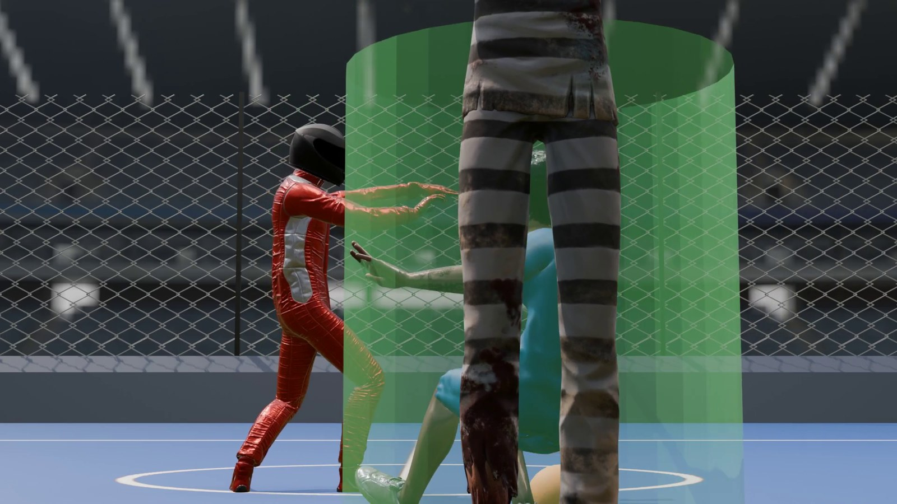
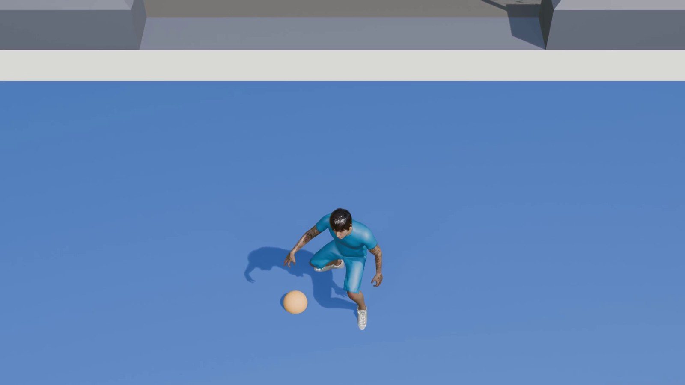
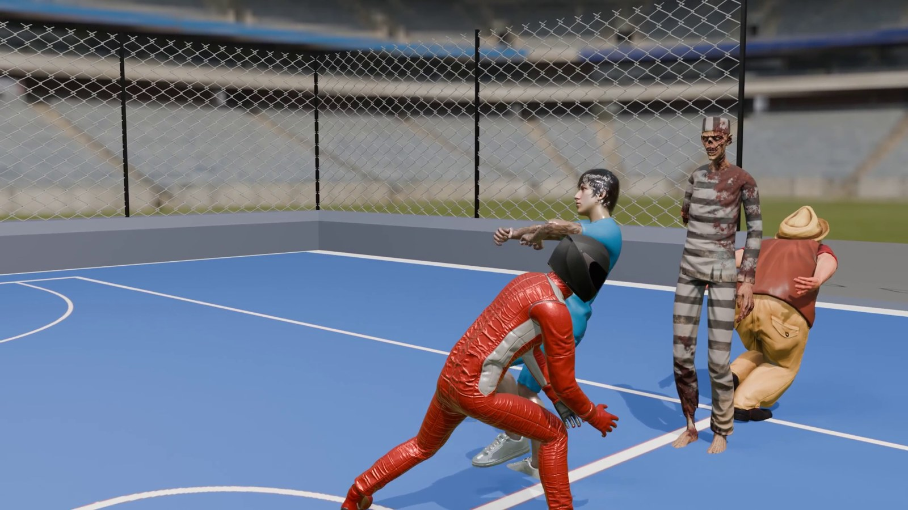
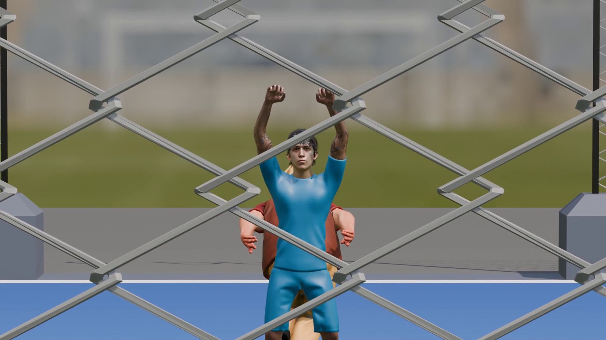
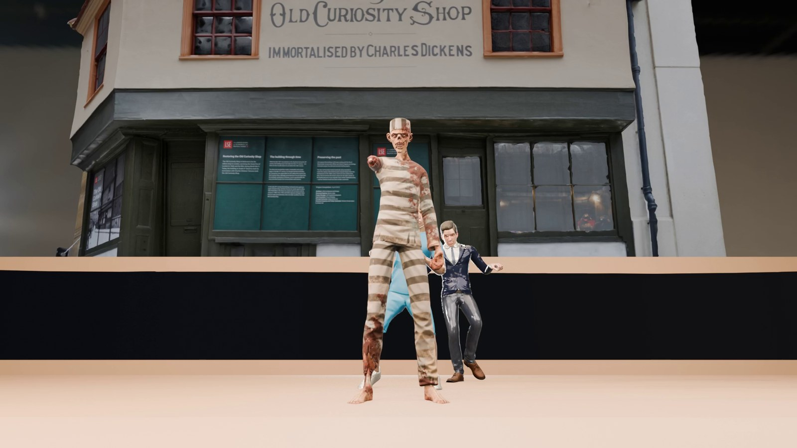
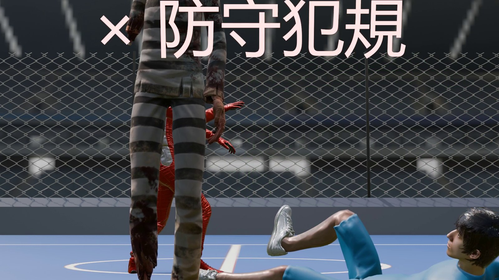
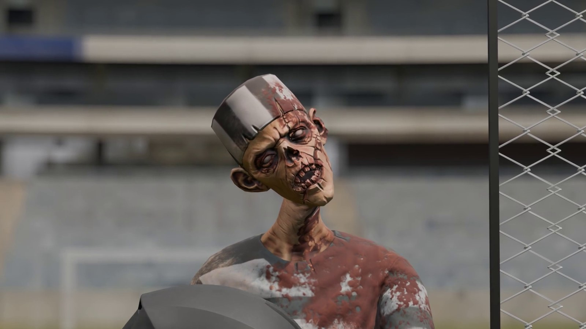
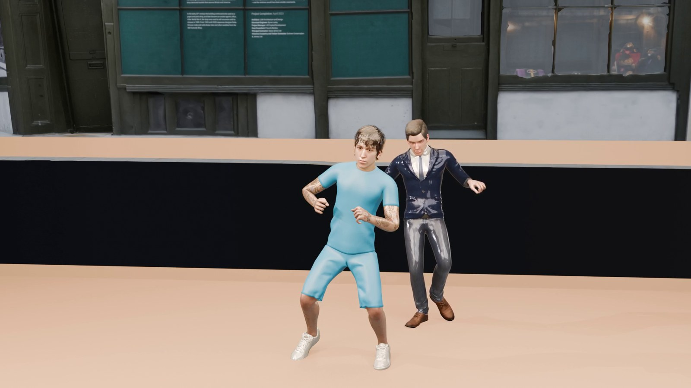

<div align="center">

# 🏀 NBA犯規機制之侵犯圓柱體規則討論及視覺化

**一支把籃球規則演到荒謬的 3D 動畫短片**
*An absurdist short visualizing the NBA verticality / cylinder foul rule.*

NYCU・電腦動畫與特效 — Computer Animation & Special Effects · Final Project

<br>


<br>

<br>
<em>用綠色的半透明圓柱，把規則裡看不見的「垂直防守空間」直接畫出來。</em>

</div>

---

## 📑 目錄 · Contents

- [這是什麼](#-這是什麼--about)
- [規格](#-規格--specs)
- [故事四幕](#-故事--story4-acts)
- [技術重點](#-技術重點--tech-highlights)
- [製作管線](#-製作管線--pipeline)
- [劇照](#-劇照--gallery)
- [Repo 內容](#-這個-repo-有什麼--repo-contents)
- [Demo 影片](#️-demo-影片--video)
- [團隊](#-團隊--team)
- [素材來源](#-素材來源--credits)

---

## 🏀 這是什麼 · About

籃球（NBA）有一條叫「**圓柱體原則**」（Principle of Verticality）的規則：防守球員對自己正上方的垂直空間有優先權，進攻方一旦侵入這個看不見的「圓柱」就算犯規。規則本身很合理，但裁判的尺度常常見仁見智。

於是我們想：**如果把這根看不見的圓柱真的畫出來、還讓它愈管愈寬，會發生什麼事？**

主角 SGA 從一場再普通不過的單打開始，被一次次莫名其妙地吹犯規，衝突一路升級到打架、甚至開槍；最後鏡頭離開球場，連他到西裝店量個身、張開雙臂，圓柱照樣罩著他、裁判也現身吹哨。我們想用這種「規則入侵日常」的荒謬感，開一個關於過度執法的玩笑。

## 📋 規格 · Specs

| 項目 | 設定 |
|---|---|
| 算圖引擎 Engine | Blender **EEVEE Next** |
| 解析度 Resolution | 1920 × 1080（Full HD）|
| 影格率 Frame rate | 60 fps |
| 片長 Runtime | 4:13（共 15,180 格）|
| 取樣 Samples | 64（TAA render samples）|
| 色彩 Color | AgX View Transform |
| 工具 Tools | Blender 5.1 · Mixamo · Poly Haven · ffmpeg |

## 🎬 故事 · Story（4 Acts）

| | |
|:--:|:--|
|  | **ACT 1** ・ 0:00–1:45<br>SGA 運球單打，示範合法攻防（綠圓柱規則講解）；接著被吹第一次「防守犯規」，搭配教學字幕。 |
|  | **ACT 2** ・ 1:45–2:48<br>第二次爭議判罰、四機位慢動作回放；情緒失控演成扭打，替補衝進來開槍，竟又造成一次防守犯規。 |
|  | **ACT 3** ・ 2:48–3:34<br>裁判舉牌判罰；防守方整隊抗議無效後棄賽，SGA 獨自慶祝（計分板 1-0）。 |
|  | **ACT 4** ・ 3:34–4:13<br>黑場轉到西裝店，裁縫量身、SGA 一張臂，圓柱罩著他；裁判慢動作走進來再吹一次，「The End」。 |

## 🛠 技術重點 · Tech Highlights

### 🟢 垂直圓柱視覺化系統（核心）


整支片技術上花最多心思的地方。圓柱是用 **Geometry Nodes** 長出來的半透明柱子（`GN_Cylinder` 修改器），顏色、發光、半徑、要不要顯示都接到幾個自訂屬性上，再用一個 **frame-change handler** 在每一格即時更新狀態、順便貼齊地面。本片圓柱維持綠色，呈現規則保護的垂直空間；系統也支援切成紅色 Emission（犯規），但這支成片沒有觸發到，犯規改由裁判舉牌和字幕表示。

> **一個中途的轉彎：** 原本想「自動」判犯規 —— 偵測手到圓柱中心小於 0.3m 就算侵入。但實測手最近只到 0.86m，門檻根本碰不到。後來改用腳本手動控制圓柱的出現與狀態（override），少了點自動的帥氣，卻更好控制劇情節奏。

<br clear="right">

### 🦴 NLA 與 Root / Rig 分離

把「走位」和「動作」拆開：`Root` 空物件用關鍵格決定角色走到哪裡，`Rig` 透過 **NLA 軌道**播放個別動作。想換動作就換軌道、想改路線就動 Root，兩邊互不干擾；頭部加 **Damped Track** 自動盯著目標。

### 🎥 運鏡・燈光・特效

四機位（`Cam_4A`–`4D`）慢動作回放、**Dolly Zoom** 拉開棄賽全景、低角 24mm 裁判登場；**HDRI** 打底 + 區域光，西裝店換暖色室內光。加上槍口閃光、子彈、計分板、距離 HUD、逐段出現的教學字幕。

## 🧩 製作管線 · Pipeline

```text
Mixamo 動作          Poly Haven HDRI         現成 GLB 模型
 (FBX, 31 個動作)     (orlando_stadium /       (球場 / 店面 /
      │               ferndale_studio)         球 / 西裝 / 哨子)
      ▼                     │                        │
┌───────────────────────────────────────────────────────────┐
│  Blender 5.1 主檔  籃球短片_主檔.blend                       │
│                                                             │
│  Root/Rig 分離 ── NLA 軌道 ── Damped Track                  │
│  Geometry Nodes 圓柱 ── frame-change handler（綠色視覺化）   │
│  四機位運鏡 ── HDRI + 區域光 ── 特效/字幕/HUD                │
└───────────────────────────────────────────────────────────┘
      │
      ▼  渲染_高畫質版.py（批次算圖：EEVEE Next, 64 samples）
   PNG 序列  renders/final/  (15,180 格)
      │
      ▼  ffmpeg 編碼
   籃球短片_成片.mp4  (1080p · 60fps · 4:13)
```

## 🖼 劇照 · Gallery

| | | |
|:--:|:--:|:--:|
| <br>合法攻防 → 被吹防守犯規 | <br>判罰的裁判特寫 | <br>西裝店量身 |

## 📂 這個 repo 有什麼 · Repo contents

| 檔案 | 說明 |
|---|---|
| `Group2_Final_Project_report.pdf` | 完整期末報告（7 頁）|
| `Group2_Final_Project_ppt.pptx` / `.pdf` | Demo 簡報（15 張）|
| `渲染_高畫質版.py` | Blender 批次算圖腳本（EEVEE Next）|
| `images/` | README 用的劇照 |

> ℹ️ 主檔 `.blend`、成片 `.mp4` 和角色／場景原始檔（約 1.3 GB）因為超過 GitHub 單檔上限，沒有放進 repo；需要的話可另外提供。

## ▶️ Demo 影片 · Video

🎥 **YouTube：** [NBA犯規機制之侵犯圓柱體規則討論及視覺化](https://youtu.be/SRWIcS5Sxe8)

## 👥 團隊 · Team

| 組員 | 學號 | 主要負責 |
|---|---|---|
| 鄭名翔 | 113950011 | 角色匯入與綁定、ACT1–2 動畫、運鏡與燈光、簡報 |
| [teammate] | [id] | 場景與道具、圓柱系統、ACT3–4 動畫、特效與字幕、算圖與後製、報告 |

投入比重約各 50%；故事發想、分鏡與整體除錯是兩人一起完成的。

## 🙏 素材來源 · Credits

- **Mixamo** (Adobe) — 角色骨架、蒙皮與動作
- **Poly Haven** — HDRI 環境光（`orlando_stadium`、`ferndale_studio_03`，CC0）
- 店面與道具 — `Old Curiosity Shop` 店面、`prom suit` 西裝等現成 GLB 模型
- **Blender 5.1 / EEVEE Next** — 建模、動畫、算圖
- **ffmpeg** — PNG 序列編碼成 MP4

<div align="center">
<br>
<sub>Made with 🏀 + Blender at NYCU · Computer Animation & Special Effects</sub>
</div>
